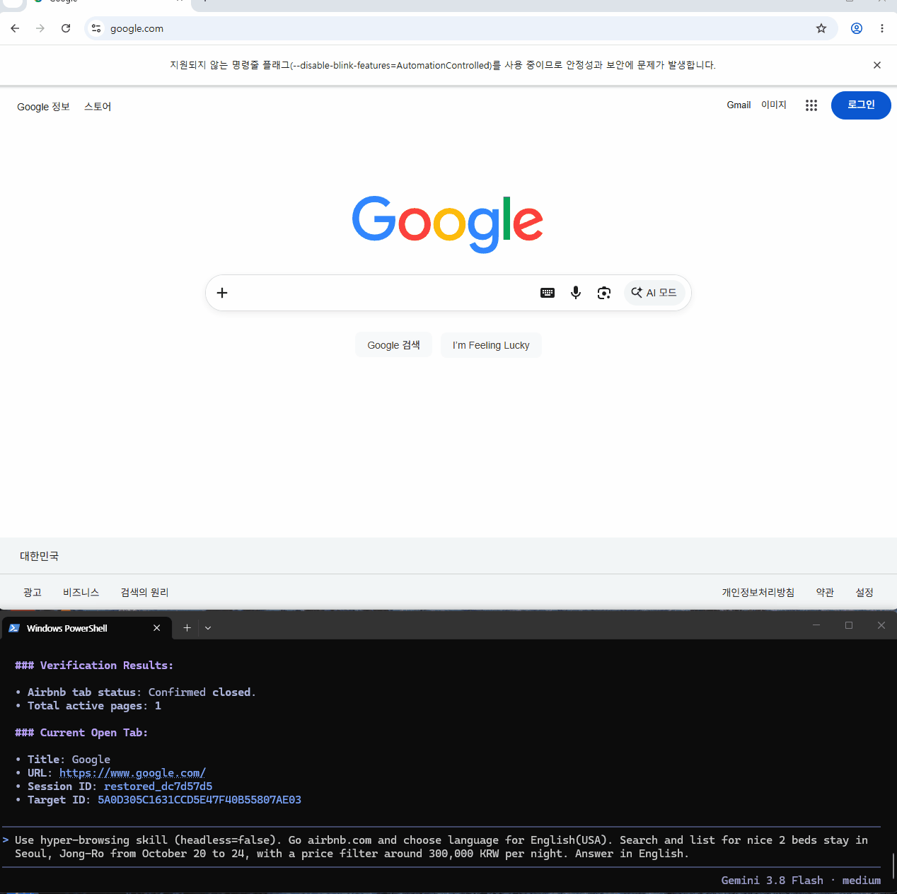
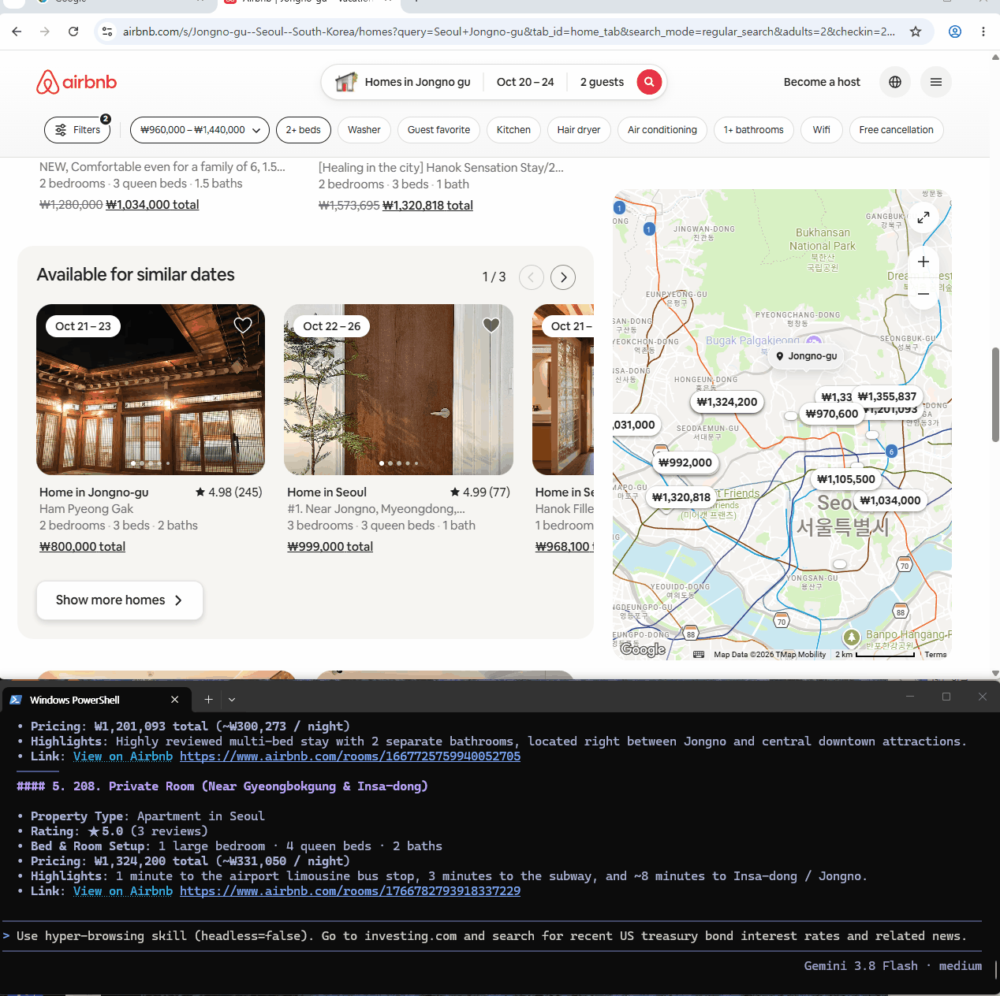

# Hyper-Browsing

**내 크롬을 그대로. AI 에이전트는 더 쉽게. 웹 자동화는 반복 없이.**

[](https://github.com/miter37/hyper-browsing/actions/workflows/ci.yml)


[English](README.md) · **한국어**

> **Hyper-Browsing은 내 컴퓨터의 Chrome을 AI 에이전트용 로컬 브라우징 런타임으로 바꿉니다.**
> 빠르고 간결한 화면 탐색, Playwright 기반 조작, Chrome 로그인 세션 활용, 사이트별 재사용 지식을 **네이티브 MCP 서버**와 기존 CLI·에이전트 스킬로 제공합니다.

유료 클라우드 브라우저 구독이 필수는 아닙니다. 브라우저와 세션은 로컬에서 관리합니다. 다만 AI 모델에 전달한 페이지 데이터는 사용한 에이전트/모델 제공자의 개인정보 처리 정책을 따를 수 있습니다.

## 빠른 시작

| 연결 방식 | 추천 대상 |
| --- | --- |
| **네이티브 MCP** | Claude Desktop, Claude Code, Cursor, Hermes 등 MCP 지원 에이전트 |
| **CLI / SKILL.md** | 코딩 에이전트, 터미널 자동화, 사이트별 러너 |
| **npm / npx** | **npm 공개 배포 이후** 간편 실행 |

### 지금 바로 사용: GitHub 소스 설치

```bash
git clone https://github.com/miter37/hyper-browsing.git
cd hyper-browsing
npm ci
node bin/hyper-browsing.mjs doctor
```

MCP 클라이언트에 아래 설정을 등록합니다. 경로는 실제 설치 경로로 바꾸세요.

```json
{
  "mcpServers": {
    "hyper-browsing": {
      "command": "node",
      "args": ["/ABSOLUTE/PATH/hyper-browsing/bin/hyper-browsing.mjs", "mcp"]
    }
  }
}
```

npm 패키지가 실제 배포된 뒤에는 `npx --yes hyper-browsing mcp`로 연결할 수 있습니다. **GitHub의 소스·브랜치에 실행 파일을 추가한 것만으로 npm 배포가 완료된 것은 아닙니다.** [설치 안내](docs/INSTALL.md) · [MCP 연결 가이드](docs/MCP.md)

### 에이전트에게 이렇게 요청해 보세요

- “이미 로그인한 사이트를 열어서 최신 결과를 읽고 정리해 줘.”
- “에어비앤비에서 조건에 맞는 숙소를 찾고 날짜·필터가 실제 적용됐는지 확인해 줘.”
- “처음 가는 사이트에서 목록을 스크롤하며 수집하고, 검증된 조회 경로는 다음에도 재사용할 수 있게 해 줘.”
- “저장된 액션을 먼저 확인하고 화면이 바뀌었다면 무작정 재실행하지 말고 현재 화면에서 복구해 줘.”

## Hyper-Browsing의 차별점

| 핵심 기능 | 실제 이점 |
| --- | --- |
| **네이티브 MCP** | 에이전트가 명령어 조합 없이 구조화된 브라우저 도구를 직접 사용 |
| **실제 로컬 Chrome** | CDP 연결과 로컬 프로필을 통한 세션 유지 |
| **간결한 관찰** | 거대한 DOM 전체 대신 필요한 요소·폼·목록만 추출 |
| **학습과 재사용** | 자주 쓰는 사이트의 액션·노하우를 검증 후 저장 |
| **안전한 실행** | 모호한 대상 거절, 참조 유효성 검사, 동작 검증, 쓰기 승인 |
| **크로스 플랫폼** | Node.js 20+ 기반 Windows/macOS/Linux |
| **로컬 우선 구조** | 필수 원격 브라우저 인프라 없이 실행 |

### 사용하면서 똑똑해지는 3단계

```text
처음 방문·구조 파악  →  조작·결과 검증  →  성공 경로 재사용
      snapshot             click/fill          사이트 액션
      forms / list         diff/verify         지식 문서
      smart-scroll         위험도 확인          UI 변경 시 재탐색
```

한 번의 작업으로 무조건 스크립트를 만들지는 않습니다. 반복 사용 가치가 확인된 지식만 제한적으로 저장하고, 바뀐 사이트는 새 관찰을 통해 검증합니다. [학습·복구 원칙](docs/LEARNING.md).

## 여러 에이전트, 하나의 브라우저 엔진

```text
Claude / Cursor / Hermes     코딩 에이전트 / 쉘
          |                         |
     MCP (stdio)                 CLI / SKILL
          +------------+------------+
                       |
              로컬 인증 RPC
                       |
                BrowserDaemon
              Playwright + Chrome CDP
                       |
               사용자 로컬 Chrome
```

MCP는 별도의 브라우저 엔진이 아니라 **기존 데몬의 안전한 연결 인터페이스**입니다. 어떤 클라이언트를 쓰든 실제 대상 선택·입력 확인·실행 결과·요청 ID 처리를 동일한 계층에서 수행합니다.

### 네이티브 MCP 핵심 도구

`browser_status` · `session_open` · `snapshot` · `forms` · `list_items` · `smart_scroll` · `dismiss_annoyances` · `click` · `fill` · `select` · `press` · `verify` · `action_list` · `run_saved_action` · `request_status`

외부 상태 변경에는 개별 사용자 승인이 필요합니다. 확인이 필요한 동작을 임의로 승인 처리하지 않으며, 임의 JavaScript 실행이나 Node 코드 실행은 MCP에 공개하지 않습니다. [MCP 안전 계약](docs/MCP.md).

## 데모

**방문했던 사이트: 준비된 Airbnb 러너로 재사용**



**새 사이트: Investing.com에서 기본 도구로 탐색**



위 영상은 기존 CLI·스킬 흐름의 예시입니다. 실제 사이트 응답시간과 로그인·접근 가능 여부는 환경에 따라 다르며, 모든 과업의 속도 향상을 보장하지 않습니다.

## CLI 빠른 사용법

```bash
node bin/hyper-browsing.mjs doctor
node bin/hyper-browsing.mjs browser start
node bin/hyper-browsing.mjs session open --url https://example.com
node bin/hyper-browsing.mjs session list
node bin/hyper-browsing.mjs mcp
```

npm CLI 사용 시 런타임 정보는 기본적으로 `~/.hyper-browsing`에 저장됩니다. `WEBAGENT_RUNTIME_DIR`로 변경할 수 있습니다. 기존 `./bin/webctl`, Windows `bin\\webctl.cmd`도 지원합니다. [전체 명령](docs/COMMANDS.md).

## 개인정보·보안 원칙

- 로컬 BrowserDaemon은 localhost와 토큰 인증을 사용하며 MCP는 로컬 stdio로 연결됩니다.
- 쿠키·Chrome 프로필은 로컬에 보관합니다. **에이전트로 전달되는 웹페이지 정보는 연결한 모델 제공자가 처리할 수 있습니다.**
- 모호한 요소는 자동 선택하지 않고, 실행 결과를 모르면 같은 쓰기 요청을 무작정 반복하지 않습니다.
- `webctl eval`과 Node 코드 액션은 기본적으로 차단돼 있습니다. 신뢰하는 환경에서만 별도로 허용하며 코드 정규식 검사는 샌드박스가 아닙니다.
- Chrome 설치가 필요하고, 로그인·CAPTCHA·2단계 인증은 사람이 직접 수행해야 할 수 있습니다.

## 개발·기여

```bash
npm ci
npm run typecheck
npm run test:mcp
npm test
npm pack --dry-run --json
```

GitHub Actions로 Linux/Windows 검증을 수행합니다. 기능 제안, 오류 재현, 기여를 환영합니다.

**[MCP 연결](docs/MCP.md) · [설치·배포](docs/INSTALL.md) · [아키텍처](docs/ARCHITECTURE.md) · [전체 CLI](docs/COMMANDS.md) · [English](README.md)**

MIT 라이선스. 독립 오픈소스 프로젝트입니다.
