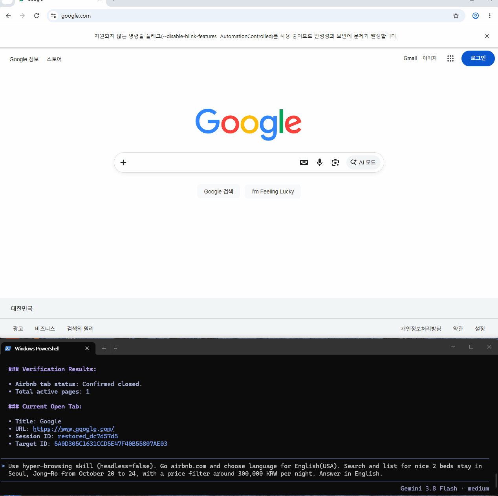
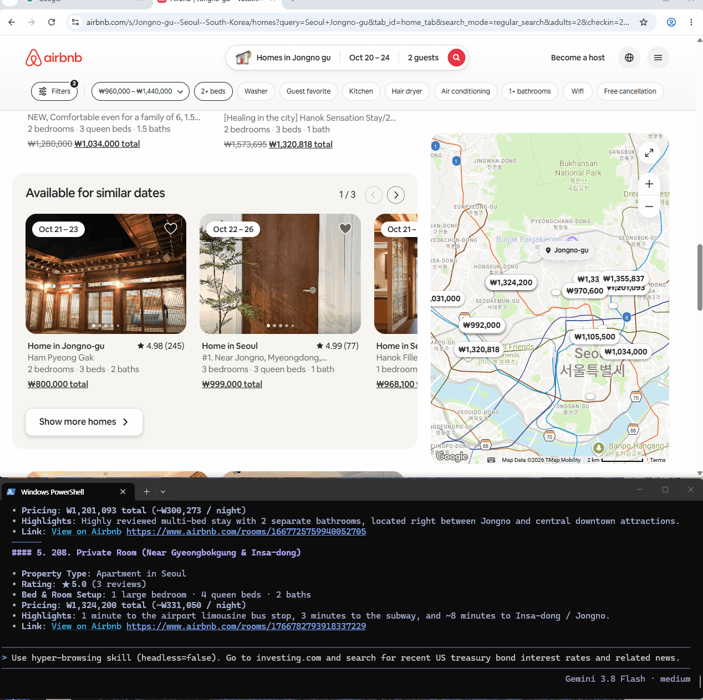

# Hyper-Browsing

<p align="right">
  <strong>English</strong> · <a href="./README.ko.md">한국어</a>
</p>

<p>
  <a href="./LICENSE"></a>
  <a href="https://github.com/miter37/hyper-browsing/actions"></a>
</p>

> **Your Chrome. Your AI agent. One local browser runtime.**
>
> Connect AI coding assistants to a real Chrome session with **native MCP**, automate known sites through **reusable workflows**, or control the browser from a **cross-platform CLI**. No hosted browser subscription, Docker, or remote credential vault required.

**Hyper-Browsing** is a local-first browser automation toolkit built on Playwright and an authenticated Chrome daemon. It turns live pages into compact, actionable observations; verifies actions instead of trusting clicks; and retains proven site knowledge for later work.

## Why build on Hyper-Browsing?

| What you get | Why it matters |
|---|---|
| **Native MCP server** | 23 typed tools for session control, snapshots, forms, virtual-list accumulation, safe interactions, verification and reusable actions |
| **One shared execution engine** | MCP and CLI use the same session store, unique-element checks, write confirmation and request tracking |
| **Your installed Chrome** | Reuse a real or agent-managed Chrome profile, including authenticated sessions when available |
| **Less repeated discovery** | Structured snapshots and verified site assets reduce the need to rediscover familiar workflows |
| **Local-first by design** | Browser profiles, cookies and runtime state stay on the machine; page content sent to your model follows that provider's policies |
| **Cross-platform** | Node.js 20+, Windows, macOS and Linux; an npm-ready `hyper-browsing` CLI with a persistent local workspace |

**Not a magic CAPTCHA bypass or a claim of universal website success.** Human login/2FA, website changes and explicit approval for purchases, messages, deletes or account changes remain part of the workflow. Benchmarks are published with their setup and limitations rather than promising unsupported speedups.

## Quick start — use the GitHub source today

**Prerequisites:** Node.js 20+, Google Chrome. On first browsing use, the daemon opens Chrome in a headless or managed profile; use `browser reveal` when a person needs to sign in.

```bash
git clone https://github.com/miter37/hyper-browsing.git
cd hyper-browsing
npm ci
node bin/hyper-browsing.mjs init
node bin/hyper-browsing.mjs doctor
```

Use the built-in **MCP server** with an MCP host:

```bash
node bin/hyper-browsing.mjs mcp
```

Or use the **CLI** without an MCP host:

```bash
node bin/hyper-browsing.mjs webctl session open --url https://example.com
node bin/hyper-browsing.mjs webctl session list
```

The MCP process speaks JSON-RPC over **stdio**. Your MCP application launches it for you; don't paste MCP tool-call JSON into a normal shell. It connects to the same authenticated local browser daemon as `webctl`. See [MCP setup and safety](docs/MCP.md).

### One-command npx experience (after npm publication)

This repository has npm packaging and an executable `bin` entry, but **the package has not been published by this change**. After the owner publishes the vetted release, the intended workflow is:

```bash
npx -y hyper-browsing@0.4.0 init
npx -y hyper-browsing@0.4.0 doctor
npx -y hyper-browsing@0.4.0 mcp
```

The npm CLI keeps runtime profiles and learned site assets under `~/.hyper-browsing/` by default—not in a disposable npx cache. Existing files in the workspace are not overwritten by startup. Change the location with `WEBAGENT_WORKSPACE_DIR`. Publishing is a separate owner action; verify the npm package name and release provenance before using registry commands.

### Connect from Claude Desktop, Cursor, Hermes or another stdio MCP host

Configure the application to launch your local checkout:

```json
{
  "mcpServers": {
    "hyper-browsing": {
      "command": "node",
      "args": ["/ABSOLUTE/PATH/hyper-browsing/bin/hyper-browsing.mjs", "mcp"]
    }
  }
}
```

Once released to npm, replace that command with `npx` and args `["-y", "hyper-browsing@0.4.0", "mcp"]`. Client-specific config locations vary; the protocol adapter is standard stdio MCP, and host integration must still be configured.

**Tool flow:** `hb_session_open` → `hb_snapshot` / `hb_forms` → `hb_click` / `hb_fill` → `hb_verify`. For changing feeds use `hb_smart_scroll`; for repeat visits use `hb_action_list` and `hb_action_run`. Write-like actions can return `confirmationRequired`; never automatically set `confirmed=true` without user approval. Lost responses return an ID for `hb_request_status`, never a blind replay.

---

### 🎬 Demo

#### 1) Known Site: Ultra-Fast Execution via Ready-Made Script (`Airbnb`)
- **Scenario**: The agent has visited Airbnb before and assetized it into a dedicated script.
- **Behavior**: Directly invokes the pre-built `airbnb_runner.mjs` without redundant DOM re-analysis or selector probing, delivering results in seconds.

<table align="center">
  <tr>
    <td>
      
    </td>
  </tr>
</table>

#### 2) New Site: Zero-Shot Browsing via Built-in Core Tools (`Investing.com`)
- **Scenario**: First time visiting Investing.com with no pre-existing site scripts.
- **Behavior**: Uses standard built-in discovery tools (`forms`, `smart-scroll`, `diff`) to inspect interactive elements and navigate the site adaptively.

<table align="center">
  <tr>
    <td>
      
    </td>
  </tr>
</table>

---

### ⚡ Highlights & Core Strengths

| Feature | Key Advantage |
| :--- | :--- |
| ⚡ **Super Fast** | Runs verified site runners directly without DOM re-analysis |
| 🪙 **Token-Light** | Filters heavy DOMs locally in Node.js to reduce the context sent to the agent |
| 🔑 **Login-Ready** | Reuses Chrome authentication when available, reducing repetitive logins |
| 🧠 **Self-Evolving** | Auto-detects broken selectors and heals scripts via discovery fallback |
| 🛠️ **Self-Customizing** | Persists proven paths as reusable local `<site>_runner.mjs` assets |
| 🔒 **Local-First** | Browser control and session data stay local; no hosted browser or remote credential store is required |

---

### 1. Core Value Proposition (3-Stage Evolution Cycle)

```text
┌────────────────────────────────────────────────────────────────────────┐
│ Stage 1: Fast Zero-Shot Inspection & Interaction                       │
│  - Rapidly scans DOM elements/structures to enable instant Playwright actions │
└──────────────────────────────────┬─────────────────────────────────────┘
                                   │
                                   ▼
┌────────────────────────────────────────────────────────────────────────┐
│ Stage 2: Deep Analysis via Standard Tooling Suite                      │
│  - Virtual DOM scrolling, live WebSocket sniffing, diffing, user intervention│
└──────────────────────────────────┬─────────────────────────────────────┘
                                   │
                                   ▼
┌────────────────────────────────────────────────────────────────────────┐
│ Stage 3: Permanent Assetization & Acceleration                         │
│  - Saves successful interaction paths as <site>_runner.mjs & SKILL.md  │
│  - Subsequent requests run verified scripts directly without re-analysis│
└────────────────────────────────────────────────────────────────────────┘
```

---

### 2. How It Works

#### 1) Instant Element Inspection & Native Chrome Playwright Connection
- Avoids dumping massive raw DOM trees into the agent context.
- Rapidly extracts interactable elements (buttons, inputs, key cards) into a clean, compact representation so the agent can click and type immediately.
- Operates directly on the user's authentic Chrome profile session via CDP, seamlessly inheriting existing logins and credentials.

#### 2) Top 6 Core Built-in Discovery & Interaction Tools
Equipped with 6 battle-tested primitives to handle modern dynamic web complexities (SPAs, virtual DOMs, popups, live streams):

1. **`dismiss-annoyances` (Blocking Overlay Cleaner)**:
   - Closes cookie/consent banners and popups on evidence only (accept buttons inside consent overlays, close buttons inside popups). Other overlays are reported, not hidden; `--force-hide` hides them.
2. **`forms` (Input Form Structure Scanner)**:
   - Scans `<form>` containers to extract input names, labels, placeholders, required flags, and submit buttons in a single structured JSON schema.
3. **`smart-scroll` (Virtual DOM Accumulator)**:
   - Continuously accumulates feed and listing nodes in memory while scrolling, preventing data loss from off-screen virtual DOM unmounting.
4. **`diff` (State Transition & Error Verifier)**:
   - Compares before-and-after snapshots of an action to detect URL changes, modal appearances, and system error alerts (`role="alert"`).
5. **`api-sniff` / `sniff-ws` (Network & WebSocket Sniffers)**:
   - Bypasses fragile DOM parsing by intercepting internal REST JSON responses and live WebSocket message streams directly from the network layer.
6. **`user-intervene` (Human-in-the-Loop Helper)**:
   - Gracefully surfaces the visible Chrome window and pauses execution when human intervention (2FA, CAPTCHAs, payments) is required, then safely resumes.

#### 3) Permanent Assetization into Dedicated Scripts & Knowledge Docs
- Successful interaction workflows can be persisted for reuse.
- Saved under `sites/<domain>/`:
  1. **Site Knowledge Document (`SKILL.md`)**: Records layouts, query quirks, and resilient selector strategies.
  2. **Universal CLI Runner (`<site>_runner.mjs`)**: Encapsulates navigation, filters, and extraction into clean CLI options.
- **Fast-Path on Return Visits**:  
  When the user makes another request for the same site, the agent skips zero-shot discovery and **calls the verified runner script directly**, responding in seconds.

---

### 3. Execution Walkthrough

#### [New Site Scenario: Discovery → Analysis → Assetization]
- **User Prompt**: *"Check the stock and price of product X on new shopping mall Y."*
- **Agent Workflow**:
  1. **Inspection**: Launches Chrome, navigates to the site, and scans buttons and input fields.
  2. **Tooling**: Uses `smart-scroll` to aggregate product listings and extracts targeted prices.
  3. **Reporting & Assetization**: Delivers the result to the user, then saves the proven search/extract workflow into `sites/y_mall/scripts/y_mall_runner.mjs` and `SKILL.md`.

#### [Known Site Scenario: Blazing-Fast Direct Path]
- **User Prompt**: *"Summarize the top 3 latest posts from my LinkedIn feed."*
- **Agent Workflow**:
  1. **Asset Detection**: Instantly spots existing `sites/linkedin/SKILL.md` and `linkedin_runner.mjs`.
  2. **Direct Execution**: Runs `node sites/linkedin/scripts/linkedin_runner.mjs feed --limit 3` without selector probing.
  3. **Instant Response**: Retrieves feed posts under the authenticated session and delivers the summary in seconds.

---

### 4. Built-in Pre-Assetized Site Runners

These legacy workflow scripts are preserved. Use them only after checking their current behavior; new shallow exploration runners use `<site>_overview.mjs`:
- **Social / Communities**: LinkedIn (`linkedin_runner.mjs`), X/Twitter (`x_runner.mjs`), Threads (`threads_runner.mjs`), Instagram (`instagram_runner.mjs`)
- **E-Commerce / Booking / Travel**: KREAM (`kream_runner.mjs`), Airbnb (`airbnb_runner.mjs`), Ticketmaster (`ticketmaster_runner.mjs`), Skyscanner (`skyscanner_runner.mjs`)
- **Finance / Research / Data**: Coinbase (`coinbase_runner.mjs`), Hyperliquid (`hyperliquid_runner.mjs`), TradingView (`tradingview_runner.mjs`), arXiv (`arxiv_runner.mjs`), Google Trends (`googletrends_runner.mjs`), Naver Real Estate (`naverland_runner.mjs`)

---

### 5. Handling Website Redesigns (Self-Healing)

When a target website changes its DOM and breaks an existing script, the system gracefully recovers:

1. **Fail-Fast Detection**: Enforces 3–5s timeouts on locators to fail fast rather than hanging for 30s.
2. **Automatic Fallback to Discovery**: Reverts to Stage 1 zero-shot mode using `dismiss-annoyances`, `diff`, and `forms` to uncover the new layout and complete the user task.
3. **Minimal Repair and Revalidation**: The agent patches the broken asset after completing and verifying the current task through discovery. Changed versions need fresh evidence. Login/network failures alone do not justify script changes; writes are never replayed just to validate a repair. Task success and repair success are reported separately.

---

### 6. Storage & Session Maintenance

Redundant background model stores, shader caches, and temporary files are blocked proactively. You can clean up runtime bloat with a single command while **100% preserving user login sessions (Cookies)**:

```bash
npm run clean
```

---

### 7. Installation, MCP and npx

Hyper-Browsing supports both the original source checkout and a packaged CLI. The native MCP stdio server is a thin, dependency-free adapter over the existing daemon; it does not create a separate Chrome driver.

**Source (available today):**

```bash
git clone https://github.com/miter37/hyper-browsing.git
cd hyper-browsing
npm ci
node bin/hyper-browsing.mjs init
node bin/hyper-browsing.mjs mcp
```

**Legacy skill usage is unchanged:** `./bin/webctl health` on macOS/Linux or `bin\webctl.cmd health` on Windows. The skill can still be cloned into an agent's skills folder. New packaged-CLI runtime paths are under `~/.hyper-browsing/`, while the existing repository launcher keeps its original checkout-local defaults.

**npx (only after npm publication by the owner):** `npx -y hyper-browsing@0.4.0 mcp`. Publishing is not part of this PR. Before release, confirm package-name ownership, install from the resulting tarball on all three supported OSes and check npm provenance.

For client configuration, available MCP tools, human approval requirements and troubleshooting, read [docs/MCP.md](docs/MCP.md). For Playwright/Chrome behavior read [docs/BROWSER.md](docs/BROWSER.md).

---

### 8. How to Prompt Your Agent (3 Practical Examples)

#### Example 1) Authenticated Social Account Task
> 💬 *"Go to my Threads feed, read the top 5 recent posts, and summarize key trends in 3 bullet points."*
- **Expected Agent Reaction**: Connects to Threads using the preserved login session and runs `threads_runner.mjs` to fetch and brief the feed.

#### Example 2) Complex Real-Time Booking / Search Task
> 💬 *"Use hyper-browsing skill to visit Ticketmaster, and find concerts or shows in Seoul on October 8 suitable to watch with my 20-something daughter."*
- **Expected Agent Reaction**: Navigates the booking portal, manipulates date/city/genre filters, and compiles available shows.

#### Example 3) New Site Discovery & Explicit Assetization Request
> 💬 *"Go to https://news.ycombinator.com, extract today's top 10 posts with titles, URLs, and upvotes. Once done, assetize it into a dedicated script so we can use it fast next time."*  
> *(※ Agents may self-learn autonomously; an explicit assetization request makes the desired script-generation step clear.)*
- **Expected Agent Reaction**: Discovers DOM elements, extracts items, and generates `sites/news_ycombinator_com/` runner and skill docs.

---

### 9. Why Local-First Browser Control

Hyper-Browsing is designed around local browser control and reusable local automation:

- 🔒 **Local Credential Handling**: Chrome profiles, cookies, and session state are kept under the local `.runtime/` directory and are not uploaded to a Hyper-Browsing service. Content returned to the AI agent may still be processed according to the model or agent provider you use.
- ⚡ **Context-Efficient Inspection**: Hyper-Browsing filters page structure locally in Node.js and returns compact, structured results instead of requiring full raw DOM dumps for routine inspection.
- 🧠 **Reusable Local Automation**: Successful workflows can be encoded as reusable `<site>_runner.mjs` files and site knowledge on your local drive, allowing repeat tasks to skip much of the discovery process.
- 💸 **No Required Browser-Service Subscription**: Hyper-Browsing does not require a hosted browser, paid proxy, CAPTCHA-solving service, or Docker. Third-party websites or services you choose to use may have their own costs.

---

### 10. Privacy & Security Policy

- **No credentials, login cookies, tokens, or personal identifiers are stored in this repository.**
- **Privileged operations are opt-in:** `webctl eval` requires `WEBAGENT_ALLOW_UNSAFE_EVAL=1` and `--confirm`; saved `actions.ts` code modules require `WEBAGENT_ALLOW_CODE_ACTIONS=1`. Both are disabled by default. Raw evaluation and custom code are not sandboxed and can bypass the ordinary click safety checks.
- **Trusted local scripts:** Scripts directly invoked with `node sites/<site>/scripts/*.mjs` are trusted local programs outside the daemon permission gate. Review them before use.
- Session profiles and cookies are kept in your local `.runtime/` directory and excluded from Git tracking. Data surfaced to the AI agent is subject to the privacy behavior of the agent/model provider you connect.

---
